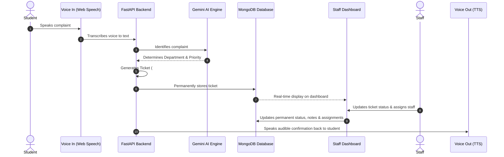

# 🎙️ VoxAct AI — Campus Voice Grievance & Auto-Ticketing System
> **College Voice AI Hackathon**  
> *End-to-End Voice AI Pipeline: Speak &bull; Triage &bull; Ticket &bull; Store &bull; Manage &bull; Confirm*

---

## ⚡ The Complete 9-Step Pipeline



### 1. Student speaks a complaint
The student clicks the microphone button (or presses the `Spacebar`) and speaks their complaint naturally:
> *"The Wi-Fi in Lab 3 is completely down since morning, we cannot access project servers."*

### 2. Voice converts into text
The browser Web Speech API transcribes interim and final speech into text in real time with an audio waveform visualizer.

### 3. Gemini identifies the complaint
The text is sent to the FastAPI backend (`POST /api/voice/process`), where Google Gemini identifies the grievance.

### 4. AI determines department and priority
Gemini automatically classifies:
- **Department**: `IT Support & Infrastructure`, `Hostel & Residential Affairs`, `Facilities & Maintenance`, `Academic & Examination Cell`, `Campus Security & Transport`, `Administration & Finance`.
- **Priority**: `Critical`, `High`, `Medium`, `Low`.
- **Summary**: Concise 1-sentence issue summary.

### 5. FastAPI creates a ticket
FastAPI generates a ticket document with a unique ID (`#GRV-xxx`), timestamp, student metadata, initial history log, and status `Open`.

### 6. MongoDB permanently stores it
FastAPI permanently writes the ticket into the MongoDB database (`voxact_campus_grievance` $\rightarrow$ collection `tickets`) at `mongodb://127.0.0.1:27017`.

### 7. Dual Dashboards display the ticket
- **Student Portal**:
  - Voice recording console, live speech-to-text transcript with 1-click copy.
  - Ticket confirmation card with Ticket ID and 1-click copy.
  - **Track Complaint Status** by Ticket ID with live timeline, assigned technician, and notes.
  * "My Recently Submitted Complaints" with direct **Track**, **Edit**, and **Delete** actions.
- **Staff / Admin Dashboard**:
  - Live metric counters (Total, Pending/Open, In Progress, Resolved/Closed).
  - Department breakdown bars & resolution rate percentage gauge.
  - Category, Priority, and Status filters with instant search.
  - Ticket cards with **Edit**, **Delete**, **Staff Triage**, and **Cycle $\rightarrow$** actions.
  - Official **PDF** report generation and **CSV** export.

### 8. Staff updates ticket status & assigns staff
Campus staff can manage complaints through:
- Staff Triage Modal with technician presets (*Vikram - IT Network*, *Suresh - Electrician*, *Ramesh - Plumbing*, *Hostel Warden Office*, *Facilities Desk*, *Dr. Sharma - Academic*) or custom staff entry.
- Quick status cycling (`Open` $\rightarrow$ `In Progress` $\rightarrow$ `Resolved`).
- Full ticket editing and deletion.
- FastAPI endpoints `PATCH /api/tickets/{ticket_id}/status`, `PUT /api/tickets/{ticket_id}`, and `DELETE /api/tickets/{ticket_id}` update MongoDB permanently.

### 9. Application speaks confirmation
The application triggers speech synthesis (`window.speechSynthesis`) to speak confirmation aloud to the student:
> *"Done. Ticket GRV-223 created for IT Support with Critical priority."*

---

## 🎨 Design Theme
- **Sidebar / Dark Background**: `#202638`
- **Primary Accent / Buttons**: `#F07864`
- **Light Background**: `#FFF9F5`
- **Cards**: `#FFFFFF`
- **Text**: `#34394A`
- **Soft Coral**: `#FCE9E3`

---

## 🚀 Running the System

### Prerequisites
- Python 3.10+
- MongoDB running locally on `mongodb://127.0.0.1:27017`
- Modern browser (Chrome / Edge recommended for Web Speech API)

### Start the Server
```powershell
python server.py
```
Open **[http://localhost:8000](http://localhost:8000)** in your browser.
